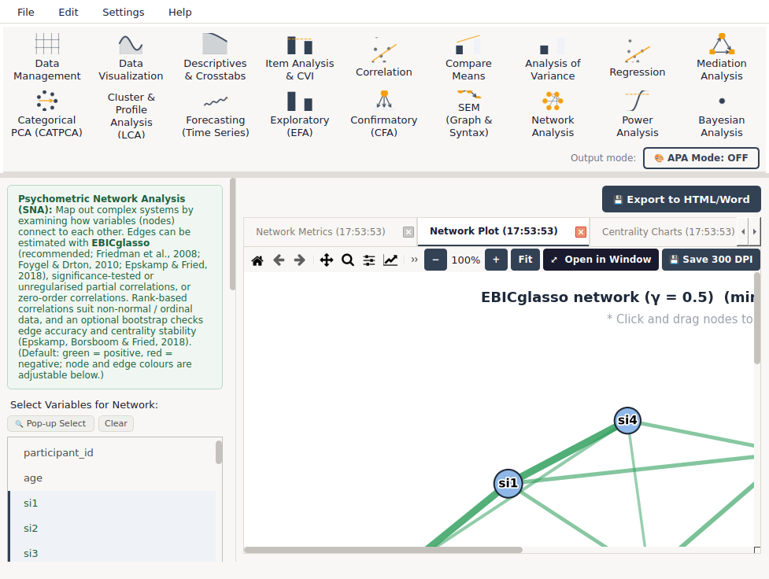
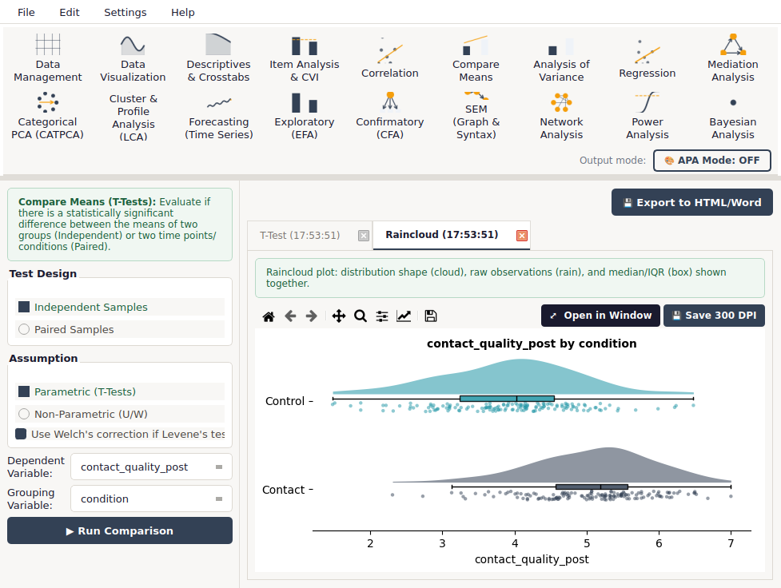
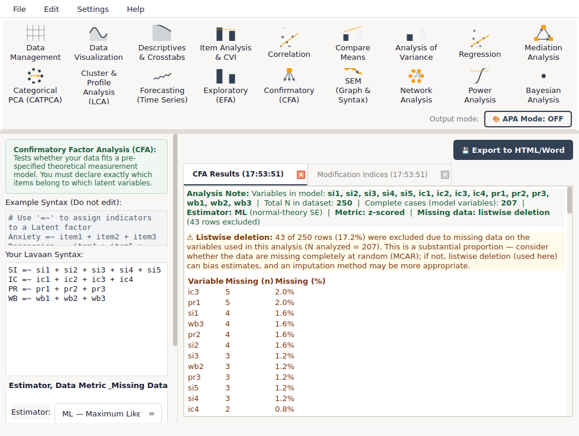

# PsyStat

**A free, open-source desktop application for statistical analysis in psychology and the social sciences.**
Point-and-click analysis with APA-style output, built for students and researchers who want more than a spreadsheet but do not want to write code.

[](LICENSE)


[](https://github.com/terysetn02-source/psystat/releases/latest)
[](https://github.com/terysetn02-source/psystat/actions/workflows/ci.yml)



PsyStat bridges the gap between programming environments (R, Python), which are powerful but have a steep learning curve, and commercial packages, which are easy to use but expensive and rigid. You load a dataset, choose variables from a list, press **Run**, and receive APA-styled tables, publication-ready charts and, for many analyses, reproducible **R and Python syntax**.

---

## Download

Go to the **[latest release](https://github.com/terysetn02-source/psystat/releases/latest)** and download the file for your system:

| System | File | Notes |
|---|---|---|
| **Windows 10/11** (64-bit) | `PsyStat-Setup-x.y.z.exe` | Installer. A portable `PsyStat-Windows-x.y.z.zip` is also provided |
| **macOS, Apple Silicon** (M1–M4) | `PsyStat-x.y.z-macOS-AppleSilicon.dmg` | Drag PsyStat to *Applications* |
| **macOS, Intel** | `PsyStat-x.y.z-macOS-Intel.dmg` | Drag PsyStat to *Applications* |

**First launch.** The app is free and not signed with a paid developer certificate, so your system will ask for confirmation once:

* **Windows:** *"Windows protected your PC"* → **More info → Run anyway**.
* **macOS:** *right-click (Control-click) PsyStat → Open → Open*, or *System Settings → Privacy & Security → Open Anyway*. If macOS says the app is "damaged": `xattr -dr com.apple.quarantine /Applications/PsyStat.app`.

Every release lists a **SHA-256 checksum** for each file (`SHA256SUMS.txt`) so you can verify your download.

---

## Features

| Area | Modules |
|---|---|
| **Data** | Import CSV / Excel / SPSS; spreadsheet-style editing with type-safe data entry; compute, recode, reverse-score, dummy-code; undo/redo; autosave and crash recovery |
| **Describe** | Data Visualization · Descriptives & Crosstabs · Item Analysis & Content Validity Index (CVI) · Correlation |
| **Compare & predict** | Compare Means (t-tests) · ANOVA, ANCOVA, MANOVA, repeated measures · Regression (OLS with hierarchical blocks, polynomial, logistic, multinomial, ordinal, ridge/lasso) · Mediation (bootstrap CI, R² for every equation) |
| **Structure & groups** | Exploratory Factor Analysis · Categorical PCA · Cluster & Profile Analysis (latent profiles, k-means, hierarchical) |
| **Latent-variable models** | Confirmatory Factor Analysis (ML or **robust MLR**, raw or standardised metric, FIML) · Structural Equation Modeling (graphical builder + syntax) · Latent Growth Curves |
| **Networks** | Psychometric Network Analysis: **EBICglasso**, significance-tested partial correlations, rank-based correlations, centrality, bridge analysis, bootstrap accuracy & stability (CS-coefficients), publication-ready plots |
| **Planning & inference** | Power Analysis (a priori, post-hoc, sensitivity; 10 designs) · **Bayesian analysis** (BF₁₀/BF₀₁, credible intervals, stated priors) · Forecasting (exponential smoothing) |
| **Output** | APA 7-style tables, an **APA mode** for black-and-white journal formatting, 300 DPI figures, export to HTML/Word |

<p align="center">
  
  
</p>

### What is new in 1.2.0

* **Network analysis:** EBICglasso and other published estimators, rank-based (Spearman / nonparanormal) input, significance-tested edges with multiple-testing correction, bootstrap accuracy and stability analysis, custom node colours for your own subscales, readable labels, scrollable plots, *Open in Window* and *Save 300 DPI*.
* **CFA:** robust **MLR** estimation (sandwich standard errors and Satorra–Bentler scaled χ² and fit indices); **raw-data metric** with unstandardised estimates in the original scale; model-implied Std.lv and Std.all; FIML that genuinely uses all rows.
* **Mediation:** R², adjusted R², F and ΔR² for every regression equation.
* **Bayesian analysis:** APA 7 / van Doorn et al. (2021) reporting: credible intervals (CrI), BF₀₁, stated priors, posterior medians, frequentist statistics kept separate; the prior settings now really affect the result.
* **Reliability fixes:** type-safe cell editing, safer autosave on shared computers, APA *p*-value formatting, compatibility with current pandas and pingouin releases, and several corrections described in the [changelog](CHANGELOG.md).

---

## Documentation

* 📖 **[User Manual](docs/USER_MANUAL.md)** ([HTML](docs/USER_MANUAL.html) · [PDF](docs/USER_MANUAL.pdf)): installation, every module step by step, tutorials, troubleshooting, references. Also available inside the app: **Help → User Manual**.
* 🧪 **[Example Datasets Guide](examples/EXAMPLES_GUIDE.md)**: four simulated datasets with variable dictionaries and an answer key. Load them from **File → Load Sample Data**.
* 🤝 **[Contributing](CONTRIBUTING.md)** · 🔒 **[Security policy](SECURITY.md)** · 📝 **[Changelog](CHANGELOG.md)**

---

## Quick start

1. Install PsyStat (see *Download*).
2. **File → Load Sample Data → Experiment Example (N=300)**.
3. Open **Compare Means**, choose *Independent Samples*, set the dependent variable to `contact_quality_post` and the grouping variable to `condition`, and press **Run Comparison**.
4. Click **Export to HTML/Word** to save the results.

The [manual's Quick Start and tutorials](docs/USER_MANUAL.md#3-quick-start-10-minutes) take you through the other modules.

---

## Run from source

Python **3.11 or 3.12** is recommended.

```bash
git clone https://github.com/terysetn02-source/psystat.git
cd psystat
python -m venv .venv
source .venv/bin/activate          # Windows: .venv\Scripts\activate
pip install -r requirements.txt
python psystat.py
```

Check that the installation is complete with `python psystat.py --selftest` (prints `ALL CHECKS PASSED`).
Exact versions used for the release are pinned in [`requirements-lock.txt`](requirements-lock.txt).

### Build the installers yourself

```bash
pip install -r requirements-dev.txt
pyinstaller --noconfirm psystat.spec          # creates dist/PsyStat
```

The GitHub Actions workflow [`build-release.yml`](.github/workflows/build-release.yml) builds the Windows installer and both macOS disk images automatically when a version tag is pushed. See [docs/RELEASING.md](docs/RELEASING.md).

---

## Scope and limitations

PsyStat is designed for teaching and for routine research analyses. It does not (yet) offer multilevel models, multiple-group SEM, imputation, or ordinal (WLSMV) estimators; the manual states the limitations of each module (Chapter 27). Results are checked against reference implementations and simulations, but **no software is bug-free: verify results that matter** with a second program, and please report discrepancies.

---

## Citing PsyStat

If you use PsyStat in published research, please cite it (GitHub's **"Cite this repository"** button uses [`CITATION.cff`](CITATION.cff)):

> Setiawan, T. (2026). *PsyStat: A statistical analysis application for psychology and the social sciences* (Version 1.2.0) [Computer software]. https://github.com/terysetn02-source/psystat

Please also cite the statistical methods you used (the manual lists references for each module).

## License

PsyStat is released under the [MIT License](LICENSE). It builds on NumPy, pandas, SciPy, statsmodels, scikit-learn, matplotlib, pingouin, semopy, factor_analyzer, prince, networkx and Qt (PyQt6), each distributed under its own licence. Note that PyQt6 is available under the GPL v3 or a commercial licence; see [NOTICE](NOTICE.md) for what this means when redistributing the application.

## Author

**Tery Setiawan**, Universitas Kristen Maranatha & Radboud University.
